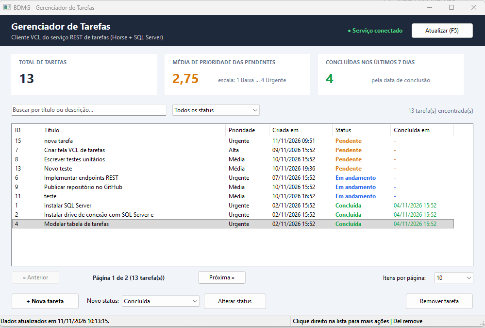
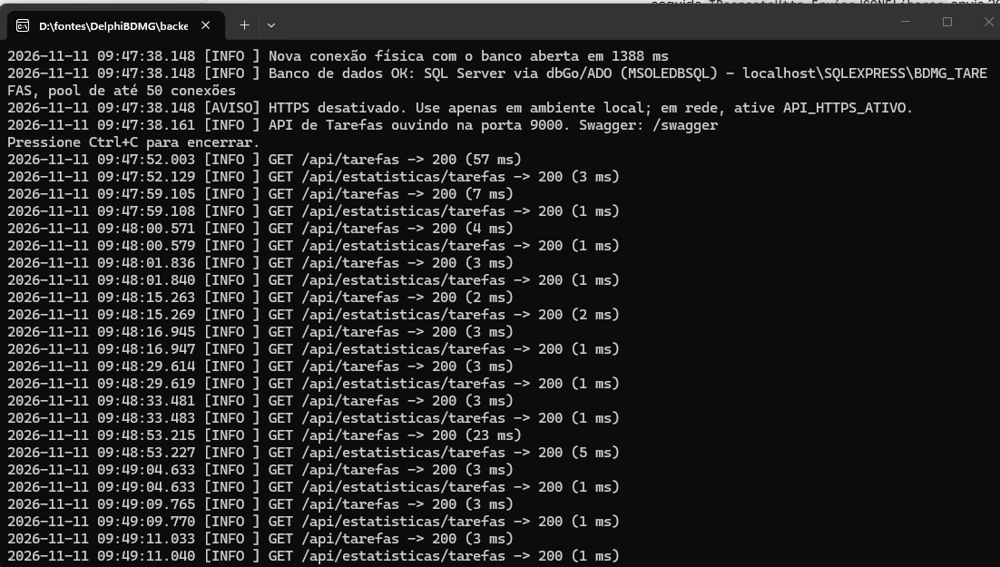
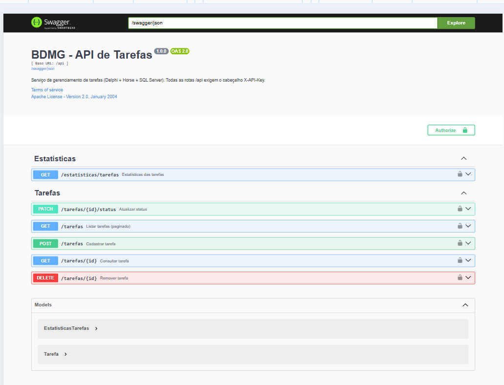

# BDMG - Gerenciador de Tarefas (Delphi + Horse + SQL Server)

Solução da prova técnica para desenvolvedor Delphi:

- **Parte 1 – Serviço REST** (`backend/`): API em Delphi com o framework **Horse**, persistência em **SQL Server**, padrões **Abstract Factory** e **Factory Method** para conexão com o banco, autenticação por chave de API e documentação **Swagger**.
- **Parte 2 – Cliente VCL** (`frontend/`): aplicação desktop que consome **exclusivamente** o serviço (sem persistência local), com listagem, cadastro, alteração de status, remoção e painel de estatísticas.

## Telas

| Cliente VCL | API (console com log de requisições) |
|---|---|
|  |  |

**Documentação Swagger** (`http://localhost:9000/swagger`). O botão **Authorize** recebe a `X-API-Key`; o valor é a constante `API_KEY` de [`Compartilhada/Comum/ConfiguracaoApi.pas`](Compartilhada/Comum/ConfiguracaoApi.pas) (veja [Onde encontrar a chave da API](#onde-encontrar-a-chave-da-api)).



O fluxo completo de uma listagem, do clique em **Atualizar (F5)** até a resposta da API, está descrito com diagramas em **[docs/FLUXO.md](docs/FLUXO.md)**.

---

## Estrutura do repositório

```
DelphiBDMG/
├── BDMGTarefas.groupproj          # Grupo de projetos (abre os três no IDE)
├── docs/                         # FLUXO.md (fluxo cliente → API → banco) + imagens das telas
├── Compartilhada/                # Código usado pela API E pelo cliente VCL
│   ├── Comum/ApiConstantes.pas   # Rotas e nome do cabeçalho de segurança
│   ├── Comum/ConfiguracaoApi.pas # API_KEY, URL/porta e opções do servidor HTTP
│   ├── Comum/Paginacao.pas       # Paginação genérica: parâmetros + TPagina<T> (reutilizável)
│   └── Models/
│       ├── BaseModel.pas         # Classe base (id, auditoria, helpers ISO 8601)
│       ├── Tarefa.pas            # Entidade Tarefa + serialização JSON + validação
│       ├── EstatisticasTarefas.pas
│       └── Enums/
│           ├── StatusTarefaEnum.pas
│           └── PrioridadeTarefaEnum.pas
├── backend/
│   ├── Api.dpr / Api.dproj       # Bootstrap do servidor Horse
│   ├── boss.json                 # Dependências (horse, gbswagger)
│   ├── DB/                       # Scripts SQL Server (01 a 04)
│   ├── src/
│   │   ├── config/               # ConfiguracaoBanco (constantes do SQL Server) e Container (DI)
│   │   ├── database/             # Abstract Factory de conexão (ADO e FireDAC) + ConsultaPaginada (OFFSET/FETCH)
│   │   ├── repositories/         # ITarefaRepository + TarefaRepository.SQLServer
│   │   ├── services/             # ITarefaService + regras de negócio
│   │   ├── controllers/          # HTTP <-> Service (TBaseController.Executar trata as exceções)
│   │   ├── http/                 # RespostaHttp: formato único das respostas JSON (sucesso/erro)
│   │   ├── middleware/           # Log de requisições e autenticação por X-API-Key
│   │   ├── log/                  # TLog: console + arquivo diário logs\api-AAAA-MM-DD.log
│   │   └── routes/               # Registro de rotas + Swagger
│   └── tests/                    # DUnitX (Service isolado com repositório em memória)
└── frontend/
    ├── Frontend.dpr / .dproj
    └── src/
        ├── services/             # ITarefaRestClient + cliente RESTRequest4Delphi + Factory + ExecutorAssincrono
        └── views/                # Telas + TarefaListViewAdapter + ComboEnumHelper + ControlePaginacao
```

---

## Estrutura de dados

Tabela `dbo.tarefas` (script `backend/DB/02_criar_tabela_tarefas.sql`):

| Coluna | Tipo | Regra |
|---|---|---|
| `id` | `BIGINT IDENTITY` | Chave primária (`pk_tarefas`) |
| `titulo` | `NVARCHAR(150)` | Obrigatório, mínimo 3 caracteres |
| `descricao` | `NVARCHAR(1000)` | Opcional |
| `prioridade` | `TINYINT` | 1 = Baixa, 2 = Média (padrão), 3 = Alta, 4 = Urgente (`CHECK 1..4`) |
| `status` | `VARCHAR(20)` | `PENDENTE` (padrão), `EM_ANDAMENTO`, `CONCLUIDA`, `CANCELADA` (`CHECK`) |
| `data_conclusao` | `DATETIME2(0)` | Preenchida pelo servidor ao concluir; nula nos demais status (`CHECK`) |
| `criado_em` | `DATETIME2(0)` | `DEFAULT SYSDATETIME()` |
| `atualizado_em` | `DATETIME2(0)` | Atualizada a cada alteração |
| `excluido_em` | `DATETIME2(0)` | Exclusão lógica (soft delete) |

Decisões de modelagem:

- **Prioridade numérica** (e não texto) para permitir calcular a **média** pedida no desafio; no código ela é o enum `TEnumPrioridadeTarefa`, então valores inválidos não circulam.
- **Status como texto legível** com `CHECK` constraint: facilita leitura direta no banco e evita “números mágicos”; no código é o enum `TEnumStatusTarefa`.
- **`data_conclusao` separada de `atualizado_em`**: “concluídas nos últimos 7 dias” precisa da data em que a tarefa foi concluída, não da última alteração qualquer.
- **Soft delete**: remover uma tarefa preenche `excluido_em`; o histórico é preservado e todas as consultas ignoram registros excluídos.
- **Índice filtrado** `idx_tarefas_status_conclusao (status, data_conclusao) INCLUDE (prioridade) WHERE excluido_em IS NULL` cobre a listagem por status e as estatísticas.
- **Usuário de banco com privilégio mínimo** (`bdmg_api`: apenas leitura/escrita de dados, sem DDL) — script `01_criar_banco.sql`.

---

## Desafio SQL

`GET /api/estatisticas/tarefas` executa **uma única consulta** com agregação condicional (ver `TarefaRepository.SQLServer.pas` e `DB/04_consultas_estatisticas.sql`, que também traz as três consultas separadas equivalentes):

```sql
SELECT COUNT(*) AS total_tarefas,
       ISNULL(CAST(AVG(CASE WHEN status = 'PENDENTE'
                            THEN CAST(prioridade AS DECIMAL(5, 2)) END) AS DECIMAL(5, 2)), 0)
         AS media_prioridade_pendentes,
       ISNULL(SUM(CASE WHEN status = 'CONCLUIDA'
                        AND data_conclusao >= DATEADD(DAY, -7, SYSDATETIME())
                       THEN 1 ELSE 0 END), 0) AS concluidas_ultimos_7_dias,
       SYSDATETIME() AS gerado_em
  FROM dbo.tarefas
 WHERE excluido_em IS NULL;
```

- Uma leitura da tabela em vez de três.
- `CAST` para `DECIMAL` evita a **divisão inteira** do SQL Server (AVG de `TINYINT` truncaria 2,33 para 2).
- `CASE` sem `ELSE` gera `NULL`, que o `AVG` ignora — a média considera apenas as pendentes.
- Filtro de data “sargable” (coluna sem função aplicada), aproveitando o índice.

Exemplo de resposta (após `03_dados_exemplo.sql`):

```json
{ "total_tarefas": 8, "media_prioridade_pendentes": 2.33, "concluidas_ultimos_7_dias": 2, "gerado_em": "2026-11-10T14:00:00.000-03:00" }
```

---

## Endpoints

Todas as rotas `/api/*` exigem o cabeçalho `X-API-Key`. Swagger UI em `http://localhost:9000/swagger` (veja a [imagem](docs/imagens/swagger.png)): clique em **Authorize**, informe a chave e use **Try it out** em cada rota.

### Onde encontrar a chave da API

A chave fica na constante `API_KEY` do arquivo [`Compartilhada/Comum/ConfiguracaoApi.pas`](Compartilhada/Comum/ConfiguracaoApi.pas):

```pascal
const
  API_KEY = '...64 caracteres hexadecimais...';
```

Para usar no Swagger:

1. abra `Compartilhada/Comum/ConfiguracaoApi.pas` e copie o valor de `API_KEY` (só o conteúdo entre aspas, sem as aspas);
2. acesse `http://localhost:9000/swagger` e clique em **Authorize**;
3. cole o valor no campo **X-API-Key** (value), confirme em **Authorize** e feche a janela;
4. os cadeados das rotas ficam fechados e as chamadas pelo **Try it out** passam a levar o cabeçalho.

A API e o cliente VCL compilam a mesma constante, então a chave do Swagger é a mesma que o cliente usa. Se a `API_KEY` for alterada, recompile a **API** e o **Frontend**. Uma chave errada ou ausente retorna **401**.

| Método | Rota | Descrição | Sucesso | Erros |
|---|---|---|---|---|
| GET | `/health` | Verificação de disponibilidade (pública) | 200 | – |
| GET | `/api/tarefas?pagina=1&tamanho=20&status=PENDENTE&prioridade=4&busca=texto` | Lista paginada (todos os parâmetros opcionais) | 200 | 400, 401 |
| GET | `/api/tarefas/:id` | Consulta uma tarefa | 200 | 400, 404 |
| POST | `/api/tarefas` | Cadastra (`titulo`, `descricao`, `prioridade`) | 201 + `Location` | 400 |
| PATCH | `/api/tarefas/:id/status` | Body `{"status":"CONCLUIDA"}` | 200 | 400, 404, 409 |
| DELETE | `/api/tarefas/:id` | Remove (soft delete) | 204 | 404 |
| GET | `/api/estatisticas/tarefas` | Indicadores do desafio SQL | 200 | 503 |

Erros sempre no formato `{"erro": true, "status": 404, "mensagem": "..."}`. Falhas de banco retornam **503** com mensagem genérica — o detalhe técnico fica apenas no log do servidor.

Exemplo com curl:

```bash
curl -H "X-API-Key: SUA_CHAVE" "http://localhost:9000/api/tarefas?pagina=1&tamanho=20"
curl -X POST -H "X-API-Key: SUA_CHAVE" -H "Content-Type: application/json" \
     -d "{\"titulo\":\"Nova tarefa\",\"prioridade\":3}" http://localhost:9000/api/tarefas
curl -X PATCH -H "X-API-Key: SUA_CHAVE" -H "Content-Type: application/json" \
     -d "{\"status\":\"CONCLUIDA\"}" http://localhost:9000/api/tarefas/1/status
```

---

## Paginação

`GET /api/tarefas` devolve uma página por vez, filtrada e paginada **no SQL Server**:

```json
{
  "itens": [ { "id": 7, "titulo": "Criar tela VCL de tarefas", "...": "..." } ],
  "pagina": 2,
  "tamanho_pagina": 20,
  "total_itens": 57,
  "total_paginas": 3
}
```

| Parâmetro | Padrão | Regra |
|---|---|---|
| `pagina` | 1 | maior ou igual a 1 |
| `tamanho` | 20 | de 1 a 100 |
| `status` | todos | `PENDENTE`, `EM_ANDAMENTO`, `CONCLUIDA`, `CANCELADA` |
| `busca` | vazio | texto no título ou na descrição (até 100 caracteres; `%`, `_` e `[` são tratados como texto) |

### Reutilização em novas rotas

A regra fica centralizada para que qualquer recurso novo seja paginado sem reescrever nada:

| Peça | Arquivo | Papel |
|---|---|---|
| Regras e modelo | `Compartilhada/Comum/Paginacao.pas` | `TParametrosPaginacao` (padrões, limites, deslocamento) e `TPagina<T>` (itens, totais, JSON). Usado pela API e pelo cliente. |
| SQL | `backend/src/database/ConsultaPaginada.pas` | `TConsultaPaginada.Executar<T>`: monta o `COUNT(*)` e o `ORDER BY ... OFFSET ... FETCH NEXT` para qualquer SELECT. |
| HTTP | `TBaseController.LerPaginacao` | Lê e valida `?pagina=&tamanho=` em qualquer controller. |
| Tela | `frontend/src/views/ControlePaginacao.pas` | Botões Anterior/Próxima, resumo e itens por página para qualquer tela VCL. |

Exemplo para um recurso novo:

```pascal
// Repositório
Result := TConsultaPaginada.Executar<TUsuario>(FConexao,
  'SELECT u.id, u.nome FROM dbo.usuarios u WHERE u.excluido_em IS NULL',
  'u.nome, u.id', APaginacao, nil,
  function(ADataSet: TDataSet): TUsuario begin Result := DatasetParaUsuario(ADataSet); end);

// Controller
LPagina := TContainer.ObterUsuarioService.Listar(LerPaginacao(Req));
```

### Por que no SQL e não em um middleware

A paginação acontece no `OFFSET/FETCH` do SQL Server: o banco lê e devolve só a página pedida. Um middleware atua depois que o controller já montou a resposta, então teria de receber **todos** os registros para só então recortar a página, o que perde o ganho de desempenho. Por isso a leitura dos parâmetros fica no `TBaseController` e o recorte, no SQL.

## Padrões de projeto e arquitetura

### Abstract Factory — conexão com o banco (`backend/src/database`)

```
IConexaoFactory ──cria──> IConexao ──cria──> IQuery
      ▲
      ├── TConexaoFactoryADO      (dbGo/ADO + MSOLEDBSQL)  ← padrão
      └── TConexaoFactoryFireDAC  (FireDAC MSSQL + pool)   ← opcional
```

- Cada fábrica concreta produz uma **família** coerente de objetos (conexão + query) da mesma tecnologia.
- O `TTarefaRepositorySQLServer` só conhece `IConexaoFactory`/`IConexao`/`IQuery`; trocar ADO por FireDAC não altera uma linha de Repository, Service ou Controller.
- Erros de cada driver são normalizados em `EConexaoException`/`EBancoDadosException`.

**Pool de conexões.** Abrir uma conexão física com o SQL Server custa cerca de 1 s (resolução da instância, TLS e login). A fábrica ADO mantém um pool próprio (`TPoolConexoesADO`): a conexão volta ao pool ao final da requisição e é reaproveitada pela próxima, o que deixa as chamadas na casa de milissegundos. Conexões que falharam são descartadas (gancho `AoFalhar` do `TQueryBase`) e as ociosas por mais de `BANCO_POOL_TEMPO_OCIOSO_SEG` são renovadas. A fábrica FireDAC usa o pool nativo do `FDManager`.

**Por que ADO é o padrão?** O driver FireDAC para SQL Server só faz parte das edições **Enterprise/Architect** do Delphi. Com ADO (dbGo), o projeto compila e roda em **qualquer edição, inclusive a Community**. Quem tiver Enterprise pode usar FireDAC: adicione `FIREDAC_MSSQL` em *Project > Options > Delphi Compiler > Conditional defines* e defina `BANCO_TIPO_CONEXAO = 'FIREDAC'` em `ConfiguracaoBanco.pas`.

### Factory Method

- `TConexaoFactory.Criar(TTipoConexao)` decide qual fábrica concreta instanciar a partir de `DB_CONEXAO`.
- `TRestClientFactory.CriarTarefaClient` (cliente VCL) entrega um `ITarefaRestClient` configurado, escondendo a biblioteca HTTP usada. Hoje a implementação usa o **RESTRequest4Delphi**.

### Interfaces e injeção de dependência

- `ITarefaService`, `ITarefaRepository`, `ITarefaRestClient` e `IConexaoFactory` desacoplam as camadas (princípio da Inversão de Dependência).
- `Container.pas` é o *composition root*: único lugar que conhece as classes concretas.

### Template Method

- `TQueryBase` (`Conexao.Base.pas`) implementa `Abrir`/`Executar` uma única vez, traduzindo qualquer erro de driver em `EBancoDadosException`; as queries ADO e FireDAC implementam só `AbrirDataSet`/`ExecutarComando`.

### Tratamento de erros sem repetição

- Cada ação do controller é escrita apenas com o caminho feliz dentro de `Executar(Res, procedure ...)`.
- `TBaseController.Executar` captura qualquer exceção e a traduz para HTTP (400/404/409/503/500).
- `LerIdParam`, `LerCorpoJSON` e `LerCampoTexto` lançam `EValidacaoException`, que vira 400 automaticamente.
- Controllers e middlewares usam `TRespostaHttp`, então toda resposta de erro tem o mesmo formato.
- Os testes substituem o repositório por um fake em memória sem tocar no Service.

### Camadas da API

`Routes → Controller → Service → Repository → IConexaoFactory → SQL Server`

O passo a passo de uma requisição por essas camadas, com diagrama de sequência, está em [docs/FLUXO.md](docs/FLUXO.md).

| Camada | Responsabilidade |
|---|---|
| Routes | Registra endpoints e documentação Swagger |
| Controller | Lê request, chama o Service, devolve JSON + status HTTP; traduz exceções |
| Service | Regras de negócio e validações (não conhece HTTP nem SQL) |
| Repository | SQL parametrizado; converte dataset em model |
| Database | Abstract Factory de conexões |

Regras de negócio implementadas no Service:

- Título obrigatório (3 a 150 caracteres); prioridade entre 1 e 4; status apenas dos valores válidos.
- Tarefa **cancelada** não pode ir direto para **concluída** (retorna 409) — precisa ser reaberta.
- Alterar para o mesmo status é idempotente (não grava).
- `data_conclusao` é definida pelo **servidor** ao concluir e limpa ao reabrir.

---

## Segurança da comunicação

- **Chave de API** obrigatória no cabeçalho `X-API-Key` para todas as rotas `/api/*` (middleware `ApiKeyMiddleware`), com:
  - comparação em **tempo constante** (evita *timing attack*);
  - chave mínima de 32 caracteres — o servidor não sobe com chave ausente ou fraca;
  - chave definida em um único lugar (`Compartilhada/Comum/ConfiguracaoApi.pas`), compilada tanto na API quanto no cliente — impossível ficarem diferentes.
- **HTTPS opcional** (`API_HTTPS_ATIVO = True` em `ConfiguracaoApi.pas` + certificado/chave PEM e DLLs do OpenSSL) — recomendado sempre que o tráfego sair de `localhost`, pois a chave viaja no cabeçalho.
- **SQL 100% parametrizado** (proteção contra SQL Injection).
- **Mensagens de erro sem detalhes internos** para o cliente; detalhes só no log do servidor.
- **Usuário de banco com privilégio mínimo** (sem permissão de DDL).

---

## Logs da API

Cada requisição e cada erro de servidor são gravados no console e em um arquivo diário, `logs\api-AAAA-MM-DD.log`, na pasta do executável. A pasta pode ser alterada em `API_LOG_PASTA` (`ConfiguracaoApi.pas`).

```
2026-11-10 19:20:15.123 [INFO ] Banco de dados OK: SQL Server via dbGo/ADO (MSOLEDBSQL) - localhost\SQLEXPRESS\BDMG_TAREFAS
2026-11-10 19:20:31.402 [INFO ] GET /api/tarefas -> 200 (14 ms)
2026-11-10 19:20:35.917 [AVISO] POST /api/tarefas -> 400 (2 ms)
2026-11-10 19:20:40.006 [AVISO] GET /api/tarefas -> 401 (0 ms)
2026-11-10 19:21:02.550 [ERRO ] Banco de dados - EBancoDadosException: ...
2026-11-10 19:21:02.551 [ERRO ] GET /api/estatisticas/tarefas -> 503 (10012 ms)
```

- **Nível pelo status:** 2xx/3xx = INFO, 4xx = AVISO, 5xx = ERRO.
- **Middleware `TLogRequisicaoMiddleware`:** é o primeiro registrado, então mede o tempo total e registra também as requisições recusadas pela chave de API.
- **Erros 500 e 503:** o detalhe técnico vai só para o log; o cliente recebe uma mensagem genérica.
- **Consultas lentas:** comandos SQL acima de `BANCO_LOG_CONSULTA_LENTA_MS` (200 ms) são registrados como AVISO com o início do SQL, e cada conexão física nova aparece como INFO com o tempo de abertura.
- **Escrita segura:** é thread-safe e não interrompe a requisição se o arquivo não puder ser gravado.

## Cliente VCL

### Comunicação com o serviço: RESTRequest4Delphi

- `TTarefaRestClient` (`frontend/src/services/TarefaRestClient.pas`) implementa `ITarefaRestClient` com o [RESTRequest4Delphi](https://github.com/viniciussanchez/RESTRequest4Delphi), usando a API encadeada (`TRequest.New.BaseURL(...).Resource(...).AddHeader(...).Get`).
- **Envio:** a chave de API vai no cabeçalho `X-API-Key`.
- **Erros:** status de erro e falhas de comunicação viram `EApiException` com a mensagem da API.
- **Conversão:** o JSON recebido é convertido nos models compartilhados.
- **Criação:** a `TRestClientFactory` cria o cliente, e as telas só conhecem a interface.

- Indicadores do desafio SQL no topo (total, média de prioridade das pendentes, concluídas em 7 dias).
- Lista **paginada** (Anterior/Próxima, "Página 2 de 3" e itens por página), com cor por status.
- Cabeçalho da grade com busca por texto e filtros por **status** e **prioridade** (1 Baixa a 4 Urgente), todos aplicados **no servidor**; a busca espera cerca de 400 ms depois da última tecla, para não enviar uma requisição a cada letra.
- **Nova tarefa** em diálogo modal com validação imediata.
- **Alterar status** pelo combo + botão ou pelo menu de contexto (clique direito).
- **Remover** com confirmação (botão, menu de contexto ou tecla Del). **F5** atualiza.
- Chamadas HTTP em **segundo plano** (`TExecutorAssincrono`, com `TTask`): a interface não trava e cada thread usa seu próprio cliente HTTP.
- A tela só coordena: a lista é montada pelo `TTarefaListViewAdapter` e os combos são ligados aos enums pelo `TComboEnumHelper` (independente da ordem dos itens).
- A validação do cadastro usa o mesmo `TTarefa.Validar` da API, sem regras duplicadas.
- Erros da API exibidos com a mensagem retornada pelo serviço; indicador “Serviço conectado/indisponível” no cabeçalho.
- Nenhum dado é gravado localmente: tudo vem do serviço a cada atualização.

---

## Configuração

Não há arquivos `.env`/`.ini`: toda configuração está em constantes Delphi, revisadas pelo compilador.

| Unit | Usada por | Conteúdo |
|---|---|---|
| `Compartilhada/Comum/ConfiguracaoApi.pas` | API e cliente VCL | `API_KEY`, `API_PORTA`, `API_URL_BASE`, `API_TIMEOUT_MS`, HTTPS e limites do servidor HTTP |
| `backend/src/config/ConfiguracaoBanco.pas` | API | Tecnologia (ADO/FireDAC), servidor, banco, autenticação, timeouts e opções do driver |

Alterou alguma constante? Recompile o(s) projeto(s) que usam a unit.

> Em um sistema real, segredos (chave de API e senha do banco) não deveriam ficar no repositório; aqui foram mantidos em constantes por simplicidade de execução da prova. Ao publicar, troque a `API_KEY` por uma chave própria.

## Como executar

### Pré-requisitos

- Delphi 12 (Community ou superior) — testado como projeto Win32.
- SQL Server 2017+ (Express ou Developer, gratuitos).
- [Microsoft OLE DB Driver for SQL Server (MSOLEDBSQL)](https://learn.microsoft.com/sql/connect/oledb/download-oledb-driver-for-sql-server).
- [boss](https://github.com/HashLoad/boss) para instalar as dependências do Horse.

### 1. Banco de dados

Execute no SSMS/Azure Data Studio, nesta ordem:

```
backend/DB/01_criar_banco.sql
backend/DB/02_criar_tabela_tarefas.sql
backend/DB/03_dados_exemplo.sql     (opcional)
```

### 2. API

```bash
cd backend
boss install github.com/hashload/horse
boss install github.com/gabrielbaltazar/gbswagger
```

Ajuste, se necessário, as constantes de `backend/src/config/ConfiguracaoBanco.pas` (padrão: `localhost\SQLEXPRESS`, banco `BDMG_TAREFAS`, autenticação do Windows).

Abra `BDMGTarefas.groupproj`, compile e execute **Api**. O console mostra a conexão com o banco e a porta (padrão 9000). Swagger: `http://localhost:9000/swagger`.

### 3. Cliente VCL

Instale a dependência do frontend (RESTRequest4Delphi):

```bash
cd frontend
boss install
```

Compile e execute **Frontend** (com a API rodando). URL, timeout e chave vêm de `Compartilhada/Comum/ConfiguracaoApi.pas`.

### 4. Testes

Compile e execute **Tests** (DUnitX). Os testes cobrem o Service com um repositório em memória — não precisam de banco.

---

## Possíveis evoluções

- Autenticação por usuário (JWT/OAuth2) quando houver múltiplos usuários.
- Paginação em `GET /api/tarefas`.
- Testes de integração do Repository contra um banco de testes.
- Pipeline de CI (GitHub Actions com runner Windows) executando a suíte DUnitX.
