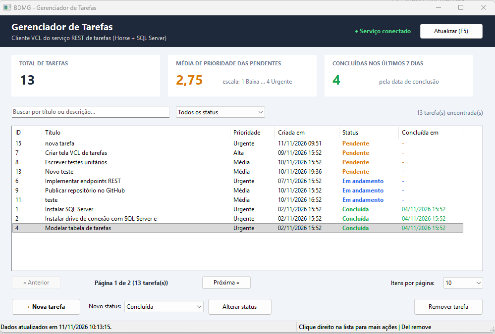
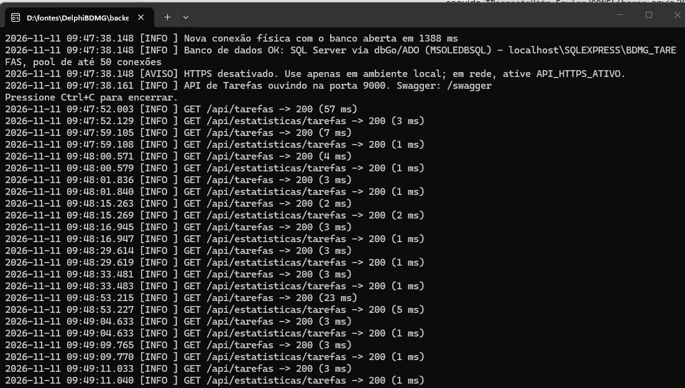
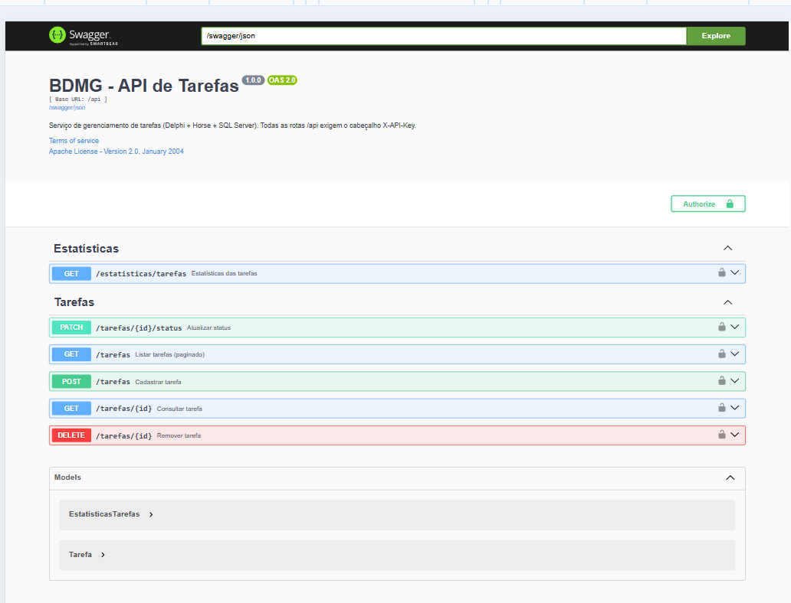
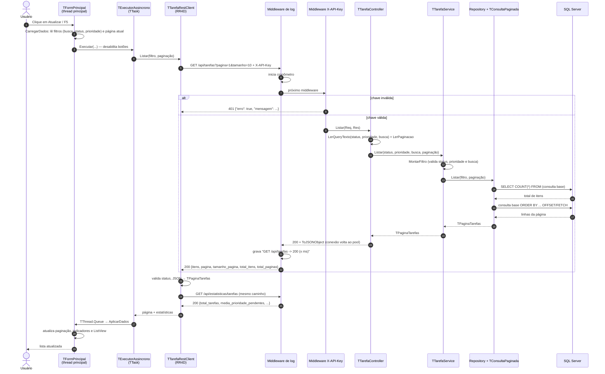
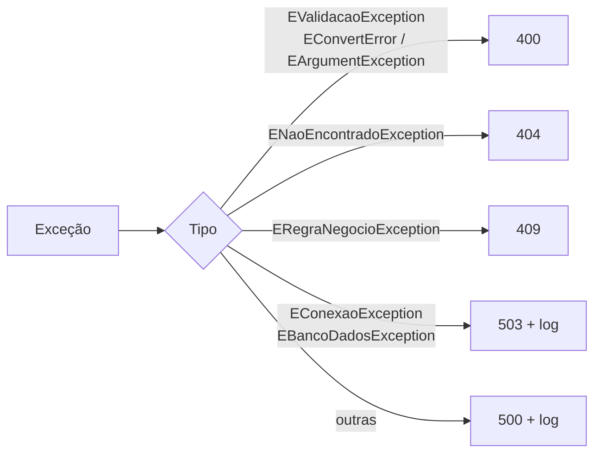

# Fluxo de funcionamento — listar tarefas

Este documento mostra o caminho completo de uma listagem de tarefas: do clique em **Atualizar (F5)** no cliente VCL até a resposta da API e a lista preenchida na tela. As demais operações (cadastrar, alterar status, remover, estatísticas) percorrem as mesmas camadas.

> Voltar para o [README](../README.md)

---

## Telas

### Cliente VCL



O topo mostra os indicadores do desafio SQL: total de tarefas, média de prioridade das pendentes e concluídas nos últimos 7 dias. Abaixo ficam:

- a busca e o filtro de status, executados no servidor;
- a lista paginada, com cor por status;
- a navegação de páginas;
- as ações (nova tarefa, alterar status, remover).

### API (console)



Na inicialização, a API valida o banco e abre a primeira conexão física do pool. Depois, cada requisição gera uma linha `MÉTODO rota -> status (tempo)`. Com o pool de conexões e o cursor somente leitura, as consultas respondem entre **1 e 7 ms**. A primeira requisição é a exceção: leva mais tempo porque inicializa a conexão.

### Documentação Swagger



Disponível em `http://localhost:9000/swagger`. Todas as rotas estão documentadas, separadas em **Tarefas** e **Estatísticas**, com os modelos `Tarefa` e `EstatisticasTarefas`. Os cadeados indicam que as rotas exigem a chave. Para testar pelo navegador:

1. clique em **Authorize** e informe a `X-API-Key`, que é o valor da constante `API_KEY` em [`Compartilhada/Comum/ConfiguracaoApi.pas`](../Compartilhada/Comum/ConfiguracaoApi.pas) (copie só o texto entre aspas);
2. abra `GET /tarefas`, clique em **Try it out** e preencha `pagina`, `tamanho`, `status`, `prioridade` ou `busca`.

---

## Visão geral

```mermaid
flowchart LR
    subgraph CLIENTE["Cliente VCL (frontend)"]
        direction TB
        UI["TFormPrincipal<br/>thread principal"]
        BG["TExecutorAssincrono<br/>thread de fundo"]
        RC["TTarefaRestClient<br/>RESTRequest4Delphi"]
        UI --> BG --> RC
    end

    subgraph API["API Horse (backend)"]
        direction TB
        MW["Middlewares<br/>log + X-API-Key"]
        CT["TTarefaController"]
        SV["TTarefaService"]
        RP["TTarefaRepositorySQLServer"]
        CP["TConsultaPaginada"]
        MW --> CT --> SV --> RP --> CP
    end

    DB[("SQL Server<br/>dbo.tarefas")]

    RC -- "GET /api/tarefas?pagina=1&tamanho=10<br/>X-API-Key" --> MW
    CP -- "COUNT + OFFSET/FETCH" --> DB
    MW -. "200 JSON {itens, totais}" .-> RC
```



---

## Sequência completa



---

## Passo a passo no cliente

| # | Onde | O que acontece | Por quê |
|---|---|---|---|
| 1 | `TFormPrincipal.btnAtualizarClick` / F5 | Chama `CarregarDados`. A busca (após 400 ms), os filtros de status e prioridade e os botões de página também chamam. | Um único ponto de entrada para recarregar a lista. |
| 2 | `CarregarDados` (thread principal) | Lê `edtBusca`, `cmbFiltroStatus`, `cmbFiltroPrioridade` e `FPaginacao.Parametros`. | Componentes VCL só podem ser lidos com segurança na thread principal. |
| 3 | `TExecutorAssincrono.Executar` | Desabilita os botões e chama `TTask.Run`. | A tela não congela enquanto espera a rede. |
| 4 | `TRestClientFactory.CriarTarefaClient` | Cria um `TTarefaRestClient` novo para a thread. | O cliente HTTP não é compartilhado entre threads; a tela só conhece a interface `ITarefaRestClient`. |
| 5 | `TTarefaRestClient.Listar` | `TRequest.New.BaseURL(...).Resource('api/tarefas').AddHeader('X-API-Key', ...).AddParam('pagina', ...)...Get` | RESTRequest4Delphi monta e envia a requisição de forma encadeada. |
| 6 | `Executar` + `LerResposta<TPaginaTarefas>` | Confere o status HTTP e converte o JSON no model compartilhado. | Falha de rede ou status de erro viram `EApiException` com a mensagem da API. |
| 7 | `ObterEstatisticas` | Segunda chamada, `GET /api/estatisticas/tarefas`, na mesma tarefa. | Os indicadores do topo ficam sempre coerentes com a lista. |
| 8 | `TThread.Queue` → `AplicarDados` | Volta para a thread principal e atualiza a paginação. Se a página pedida não existir mais (ex.: após excluir), recarrega sozinho. | Só a thread principal pode alterar a tela. |
| 9 | `TTarefaListViewAdapter.Preencher` | Preenche o ListView com cor por status e mantém a seleção. | A tela só coordena; a montagem da lista fica no adapter. |

---

## Passo a passo na API

| # | Onde | O que acontece | Por quê |
|---|---|---|---|
| 1 | `TLogRequisicaoMiddleware` | Primeiro middleware registrado: inicia o cronômetro e, no `finally`, grava a linha de log. | Toda requisição é registrada, inclusive as que falham. |
| 2 | `TApiKeyMiddleware` | Compara o `X-API-Key` em tempo constante. Se inválido, responde 401 e para. | Segurança: sem chave, a requisição não chega ao controller. A comparação em tempo constante evita ataque de temporização. |
| 3 | `TTarefaController.Listar` | Dentro de `Executar(Res, ...)`: lê `status`, `prioridade` e `busca`, e `LerPaginacao` cria `TParametrosPaginacao` (página ≥ 1, tamanho ≤ 100). | O controller só traduz HTTP ↔ service; os erros são tratados em um único lugar. |
| 4 | `TContainer` + `TConexaoFactory` | Monta service e repositório e obtém uma conexão do pool ADO. | Composition root com Abstract Factory: trocar de banco ou de tecnologia não afeta as camadas acima. |
| 5 | `TTarefaService.Listar` | `MontarFiltro` valida status, prioridade (1 a 4) e tamanho da busca. | Regras de negócio sem conhecer HTTP nem SQL; testadas com repositório em memória. |
| 6 | `TTarefaRepositorySQLServer.Listar` | SQL base + filtros opcionais, LIKE escapado (`%`, `_`, `[`), tudo parametrizado. | Evita SQL injection e mantém a ordenação estável. |
| 7 | `TConsultaPaginada.Executar<T>` | `SELECT COUNT(*)` para os totais e `ORDER BY ... OFFSET/FETCH` para a página. | Paginação no banco: só as linhas da página trafegam. A classe é reutilizável por novas rotas. |
| 8 | `TQueryADO` / `TQueryBase.Abrir` | Cursor somente leitura e só para frente; registra no log as consultas acima de 200 ms. | Desempenho de 1 a 7 ms e diagnóstico de lentidão. |
| 9 | `TRespostaHttp.EnviarJSONELiberar` | Envia 200 com `TPagina.ToJSONObject`. | Formato único de resposta para toda a API. |
| 10 | Liberação | Repositório liberado; a conexão volta ao pool. | A próxima requisição reaproveita a conexão física já aberta. |

---

## Exemplo de requisição e resposta

```http
GET /api/tarefas?pagina=1&tamanho=10 HTTP/1.1
Host: localhost:9000
Accept: application/json
X-API-Key: <API_KEY de ConfiguracaoApi.pas>
```

```json
{
  "itens": [
    {
      "id": 15,
      "titulo": "nova tarefa",
      "descricao": "",
      "prioridade": 4,
      "prioridade_descricao": "Urgente",
      "status": "PENDENTE",
      "data_conclusao": null,
      "criado_em": "2026-11-11T09:51:00.000-03:00",
      "atualizado_em": "2026-11-11T09:51:00.000-03:00"
    }
  ],
  "pagina": 1,
  "tamanho_pagina": 10,
  "total_itens": 13,
  "total_paginas": 2
}
```

Na tela, esses totais aparecem como "Página 1 de 2 (13 tarefa(s))".

---

## Quando algo dá errado

Qualquer exceção levantada no controller, no service ou no repositório é tratada por `TBaseController.TratarExcecao`. O cliente lê o campo `mensagem` e mostra ao usuário.



| Situação | Status | Resposta |
|---|---|---|
| Chave ausente ou inválida | 401 | `{"erro": true, "status": 401, "mensagem": "..."}` (middleware) |
| Parâmetro inválido (ex.: `pagina=0`, status desconhecido, `prioridade=5`) | 400 | mensagem de validação |
| Tarefa não encontrada | 404 | mensagem do service |
| Regra de negócio (ex.: cancelada → concluída) | 409 | mensagem do service |
| Banco indisponível | 503 | mensagem genérica; o detalhe técnico fica só no log |
| API fora do ar | — | o cliente mostra "Não foi possível comunicar com o serviço" |
